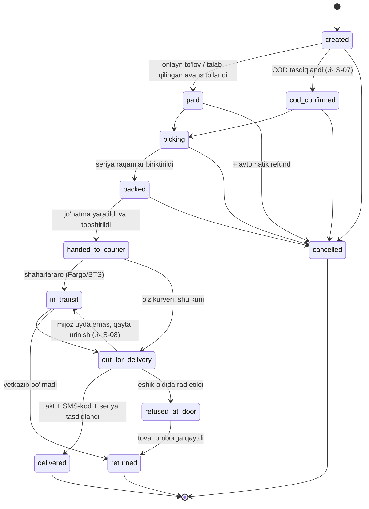

# 01. Arxitektura

> Holat: **loyiha (draft)**. [04-savollar.md](04-savollar.md) dagi savollarga javob
> olingach yakunlanadi. Javobga bog'liq joylar `⚠️ S-NN` deb belgilangan.

## 1. Texnologik tanlov

| Qatlam | Tanlov | Sabab |
|---|---|---|
| Backend | **Python 3.12 + Django 5 + Django REST Framework** | Tayyor admin, ORM + migratsiyalar, guruh/ruxsat tizimi (rollar), Celery bilan yetuk integratsiya. FastAPI'ga nisbatan MVP tezroq chiqadi. |
| OpenAPI | `drf-spectacular` | `/api/schema/`, `/api/docs/` (Swagger), `/api/redoc/` |
| Auth | SMS OTP + JWT (`djangorestframework-simplejwt`) | access 15 daqiqa, refresh 30 kun, refresh rotation + blacklist |
| DB | **PostgreSQL 16 + PostGIS** | Kuryer zonalari (poligon), manzil koordinatalari |
| Kesh / navbat | Redis 7 | OTP, kesh, rate-limit, Celery broker, circuit breaker |
| Fon vazifalar | Celery + celery-beat | rezervlar muddati, tracking polling, SMS, fiskal chek, hisobotlar |
| Qidiruv | Meilisearch | Typo-tolerance, faset filtrlar, 3 til uchun alohida indeks |
| Fayllar | S3-mos (MinIO, O'zbekistondagi serverda) | Rasmlar, topshirish akti foto, Excel importlar |
| Konteyner | Docker + docker compose (prod: compose yoki k8s) | |
| Mijoz veb | Next.js 15 (App Router, SSR — SEO uchun) | |
| Mobil | Flutter (xaridor ilovasi + kuryer ilovasi, umumiy `core` paket) | |
| Boshqaruv paneli | MVP: Django Admin (Unfold mavzusi) + maxsus sahifalar; keyin alohida React | ⚠️ S-01 |
| CI/CD | GitHub Actions: lint (ruff), test (pytest + Postgres/Redis servislari), Docker build, deploy | |

## 2. Monorepo tuzilmasi

```
backend/
  config/                 settings (base/dev/prod/test), urls, celery, asgi/wsgi
  apps/
    core/                 umumiy: BaseModel, pul tipi, audit log, sozlamalar, i18n yordamchilari
    accounts/             foydalanuvchi, OTP, rollar, manzillar
    geo/                  viloyat/tuman/aholi punkti, provayder kodlari bilan mapping
    catalog/              kategoriya, brend, tovar, variant (SKU), atribut, rasm, sevimli, solishtirish
    inventory/            ombor, qoldiq, rezerv, harakatlar, seriya/IMEI
    cart/                 savat (mehmon + foydalanuvchi)
    orders/               buyurtma, statuslar mashinasi, checkout
    payments/             Payme, Click, Uzum Bank, naqd/terminal, qaytarish, OFD chek
    installments/         nasiya hamkori moduli (alohida, plaginli)
    logistics/            DeliveryProvider, smart routing, jo'natma, marshrut, topshirish akti, COD kassasi
    warranty/             kafolat kartasi, qaytarish/kafolat arizalari
    reviews/              sharhlar, savol-javob
    promotions/           aksiyalar, promo-kodlar, bannerlar
    notifications/        SMS, push, shablonlar
    admin_api/            xodimlar uchun API + hisobotlar
    backoffice/           1C o'rniga: ta'minotchilar, kirim hujjatlari, ko'chirish, hisobdan chiqarish, kassa
  tests/
web/                      Next.js (xaridor)
mobile/                   Flutter (xaridor)
courier_app/              Flutter (kuryer)
infra/                    docker-compose, nginx, backup skriptlari
docs/
```

## 3. Buyurtma statuslari mashinasi



Qoidalar:
- O'tishlar faqat `orders.services.transition(order, to, actor)` orqali, `select_for_update` bilan;
  har o'tish `order_status_history` ga yoziladi va signal (SMS/push, rezerv, hisobotlar) chaqiradi.
- `paid` — "to'lov talabi bajarildi" degani (to'liq yoki talab qilingan avans). Haqiqiy pul holati
  alohida `payment_status` maydonida (`unpaid / partially_paid / paid / refunded / partially_refunded`).
- `delivered` dan keyin qaytarish — alohida `warranty.return_request` obyekti, buyurtma statusi o'zgarmaydi.

## 4. Logistika: DeliveryProvider va smart routing

```python
class DeliveryProvider(Protocol):
    code: str                                   # "own" | "fargo" | "bts"
    def supports(self, req: QuoteRequest) -> bool: ...          # zona, vazn, gabarit, COD, yirik tovar
    def calculate(self, req: QuoteRequest) -> Quote: ...         # narx (bizga xarajat), muddat
    def create_shipment(self, sh: Shipment) -> ShipmentResult: ...
    def track(self, sh: Shipment) -> list[TrackingEvent]: ...    # normallashtirilgan statuslar
    def cancel(self, sh: Shipment) -> CancelResult: ...
```

| Implementatsiya | Manba |
|---|---|
| `OwnCourierProvider` | Ichki tariflar jadvali (`delivery_tariff`), zona poligoni (PostGIS), marshrut sig'imi |
| `BTSProvider` | `http://api.bts.uz`, Bearer token: `order/calculate`, `order/add`, `order/track`, `order/history`, `order/cancel` (⚠️ S-11) |
| `FargoProvider` | Fargo API (⚠️ S-12 — hujjat kerak) |

Smart routing algoritmi (checkout'da `POST /checkout/delivery-options`):
1. `QuoteRequest` yig'iladi: manzil (tuman, koordinata), savat og'irligi/gabariti, yirik tovar bormi,
   qavat/lift, COD summasi, jo'natiladigan ombor.
2. `supports()` dan o'tgan provayderlarga `calculate()` **parallel**, har biriga timeout 3 s.
3. Redis'dagi circuit breaker: provayder ketma-ket N marta xato bersa, 5 daqiqa so'ralmaydi.
4. Javoblar reytinglanadi: `score = narx + λ × muddat_kun + ishonchlilik_jarimasi` (⚠️ S-09 — mezon).
5. Eng yaxshisi tanlanadi, quote `delivery_quote` ga 15 daqiqa muddat bilan saqlanadi (mijoz narxi qotadi).
6. `create_shipment()` (status `packed` dan keyin) tanlangan provayderda ishlamasa — reyting bo'yicha
   keyingisiga o'tiladi. Hammasi ishlamasa — buyurtma `packed` da qoladi, logistika menejeriga alert.
7. Tracking: webhook bo'lsa — webhook, bo'lmasa Celery har 30 daqiqada `track()` qiladi.

Yirik texnika (`product.is_bulky = true`):
- Checkout'da qavat, lift turi (`none / passenger / freight`), "qavatgacha ko'tarish" xizmati so'raladi.
- O'z kuryerida yuk mashinasi tarifi (`vehicle_type = truck`) va ko'tarish narxi
  (`lift_price_per_floor`, liftsiz; lift bilan — `lift_price_with_elevator`) qo'llanadi.
- Fargo/BTS yirik tovar va ko'tarishni qabul qiladimi — ⚠️ S-10.

## 5. Eshik oldida tekshirish (topshirish akti)

Kuryer ilovasida ketma-ket qadamlar (har biri `delivery_handover` ga yoziladi):
1. Qadoqni ochish → foto (kamida 1 ta).
2. Yoqib ko'rish (`powered_on_checked`) → foto/video ixtiyoriy.
3. Seriya raqam / IMEI ni skanerlash → buyurtmaga biriktirilganiga mos kelishi **majburiy**.
4. To'lov (COD bo'lsa): naqd yoki terminal summasi.
5. Mijoz telefoniga SMS-kod yuboriladi → kuryer kiritadi → tasdiqlanadi.
6. Akt PDF generatsiya qilinadi (S3), mijozga havola SMS orqali yuboriladi.
Rad etilsa — sabab + foto, status `refused_at_door`.

Fargo/BTS orqali yetkaziladigan buyurtmalarda bu jarayonni kim bajaradi — ⚠️ S-13.

## 6. To'lovlar

| Provayder | Protokol | Imzo / autentifikatsiya tekshiruvi |
|---|---|---|
| Payme (Merchant API) | JSON-RPC: `CheckPerformTransaction`, `CreateTransaction`, `PerformTransaction`, `CancelTransaction`, `CheckTransaction`, `GetStatement` | `Authorization: Basic` (merchant key) + IP allowlist; summa **tiyin**da |
| Click (SHOP API) | `prepare` / `complete` | `sign_string` MD5 qayta hisoblanib solishtiriladi, `sign_time` tekshiriladi |
| Uzum Bank (Merchant API) | `check` / `create` / `confirm` / `reverse` / `status` | Hujjatdagi autentifikatsiya + IP allowlist (⚠️ S-14) |
| Naqd / terminal | Kuryer ilovasidan | Kuryer kassasi + akt |

Umumiy qoidalar:
- Har bir webhook avval `payment_webhook_log` ga xom holda yoziladi, keyin imzo tekshiriladi;
  imzo xato bo'lsa — provayder talab qilgan xato kodi qaytariladi va hech narsa o'zgarmaydi.
- Idempotentlik: `(provider, provider_transaction_id)` unikal.
- Summa, buyurtma holati, valyuta serverda qayta tekshiriladi (mijozdan kelgan summaga ishonilmaydi).
- `cod_max_amount` sozlamasidan qimmat buyurtmada COD o'chadi: avans (`prepayment_percent`) yoki
  to'liq oldindan to'lov talab qilinadi (⚠️ S-06).
- Har bir to'lov/qaytarishga fiskal chek: `fiscal_receipt` (MXIK/IKPU kodi, qadoq kodi, QQS) (⚠️ S-15).

## 7. Shaxsiy ma'lumotlar va xavfsizlik

- PostgreSQL, Redis, MinIO, backup — **O'zbekiston hududidagi serverda** (O'zbekiston qonunchiligidagi
  shaxsiy ma'lumotlarni lokalizatsiya qilish talabi). Shaxsiy ma'lumot bo'lmagan statik fayllar CDN orqali berilishi mumkin.
- Rollar: `customer`, `courier`, `warehouse`, `logistics_manager`, `content_manager`, `support`, `finance`, `admin`.
- Kuryer mijoz telefoni va manzilini faqat o'ziga biriktirilgan, faol jo'natmalar uchun ko'radi.
- Mijozlar ro'yxati, telefon eksporti va nasiya arizasidagi pasport/PINFL ma'lumotlarini ko'rish
  `audit_log` ga yoziladi; pasport/PINFL maydonlari shifrlangan holda saqlanadi.
- OTP: 6 xonali, 2 daqiqa amal qiladi, 5 urinish, telefon + IP bo'yicha rate-limit.
- Barcha tashqi kalitlar — env/secret manager'da, repoda emas.

## 8. Back-office (1C o'rniga)

1C ishlatilmaydi: narx, qoldiq, tannarx va sotuvlarning **yagona manbai — shu tizim**. 1C'da bo'ladigan
asosiy ish jarayonlari boshqaruv panelida quriladi:

| Jarayon | Holat |
|---|---|
| Ombor qoldig'i, kirim (seriya/IMEI bilan), inventarizatsiya, harakatlar jurnali | ✅ inventory |
| Narxlar (qo'lda + Excel), narx tarixi | ✅ catalog |
| Ta'minotchilar va kirim hujjatlari (xarid narxi bilan → o'rtacha tannarx) | ⏳ backoffice |
| Omborlar orasida ko'chirish, hisobdan chiqarish (brak) | ⏳ backoffice |
| Kassa: kuryerlardan naqd qabul qilish, to'lov tizimlari bo'yicha tushum | ⏳ payments/logistics |
| Hisobotlar: sotuv, marja, yetkazish xarajati, qoldiq qiymati | ⏳ admin |

Buxgalteriya hisobi va soliq hisobotlari bu tizim doirasiga kirmaydi (⚠️ S-24); fiskal cheklar OFD orqali chiqariladi.

## 9. Kuzatuv va ekspluatatsiya

- Sentry (xatolar), Prometheus + Grafana (metrikalar: provayder javob vaqti, to'lov xatolari,
  fon vazifalar navbati), JSON formatdagi strukturalangan loglar.
- PostgreSQL: kunlik to'liq backup + WAL arxivi (PITR), backup ham O'zbekiston hududida saqlanadi.

## 10. Muhitlar (environments)

| Muhit | Joy | Maqsad | Ma'lumotlar |
|---|---|---|---|
| **demo / staging** | **Hugging Face Spaces** (bepul, Docker Space) | Ko'rsatish, test, mobil ilovalarni ulash | Faqat soxta (test) ma'lumotlar |
| **production** | O'zbekistondagi server (⚠️ S-20) | Haqiqiy savdo | Haqiqiy mijozlar ma'lumoti |

Hugging Face Spaces cheklovlari va yechimlar:
- Bitta konteyner, tashqi port faqat `7860` → `infra/hf-space/Dockerfile` ichida supervisord bilan
  nginx + gunicorn (Django) + Celery worker/beat + PostgreSQL + Redis + Meilisearch birga ishga tushadi.
- Bepul tarifda disk doimiy emas va Space faolsiz qolsa uxlab qoladi → har ishga tushishda
  migratsiya + demo ma'lumotlar (`manage.py seed_demo`) avtomatik yuklanadi.
- Tashqi provayderlar (Payme, Click, Uzum, BTS, Fargo, SMS, OFD) demo'da **sandbox/test** rejimida
  yoki "fake" implementatsiya bilan ishlaydi; SMS-kod demo'da ekranda/logda ko'rsatiladi.
- Kalitlar Space'ning **Secrets** bo'limida saqlanadi, repoda emas.
- **Haqiqiy mijozlarning shaxsiy ma'lumotlari Hugging Face'ga hech qachon yuklanmaydi** —
  qonunga ko'ra ular O'zbekistondagi serverda bo'lishi shart.
- Deploy: GitHub Actions → `huggingface.co` dagi Space git repoga push (HF write token GitHub Secrets'da).
