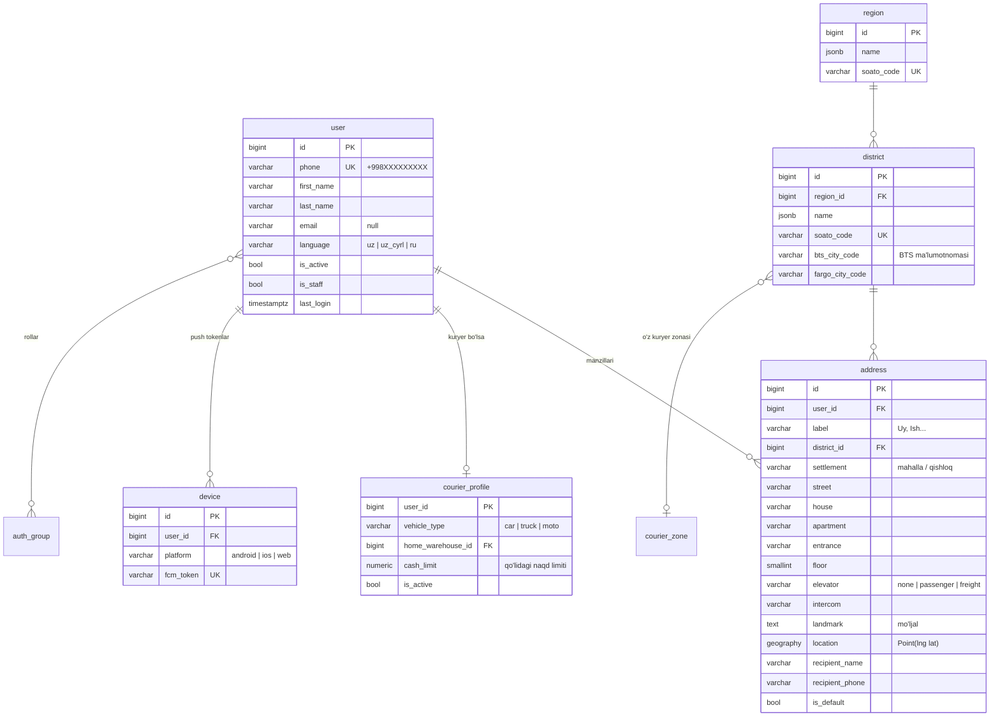
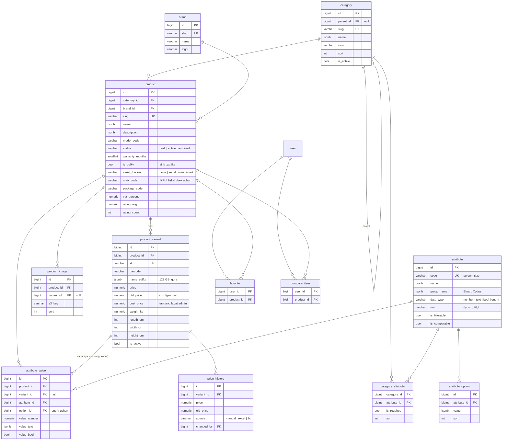
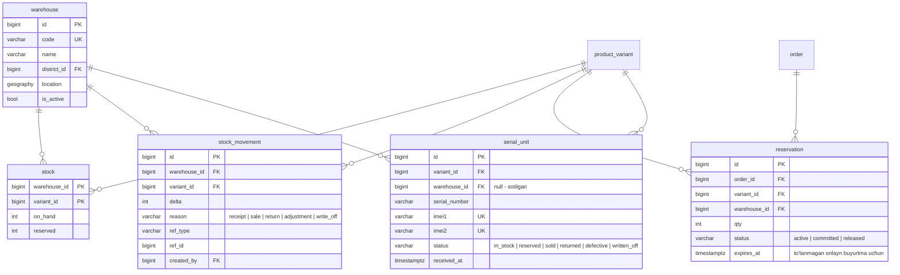
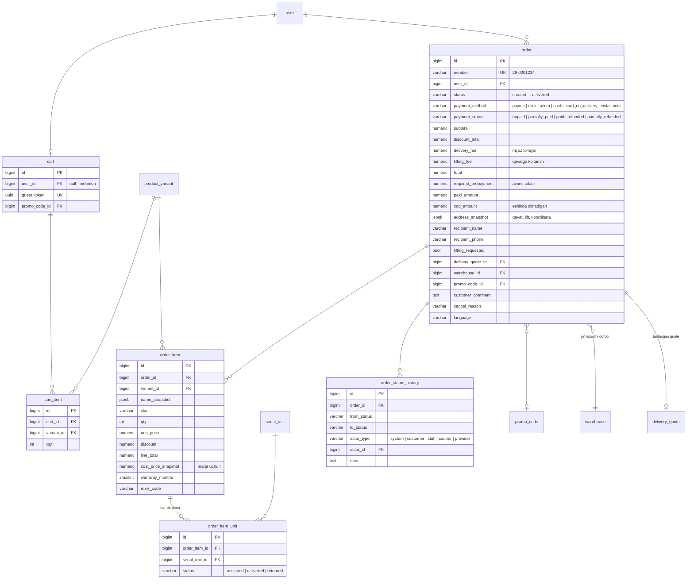
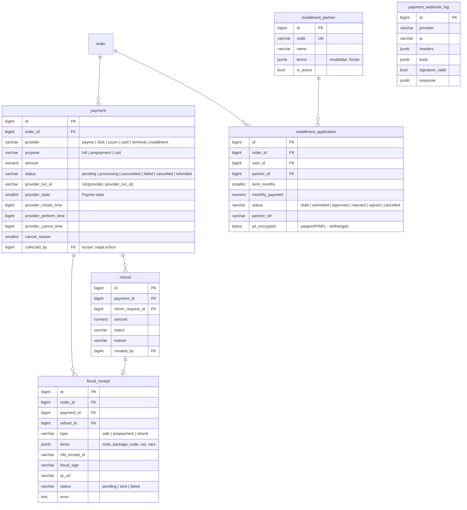
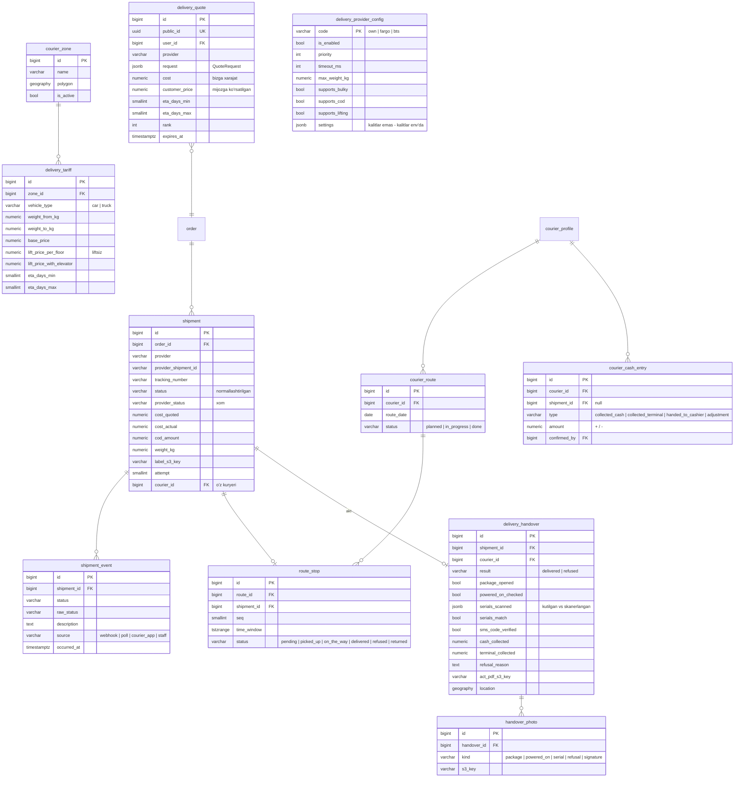
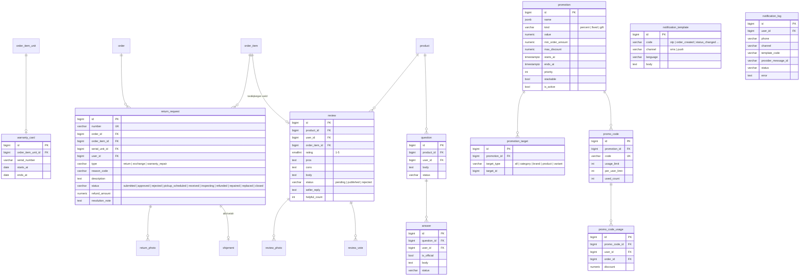
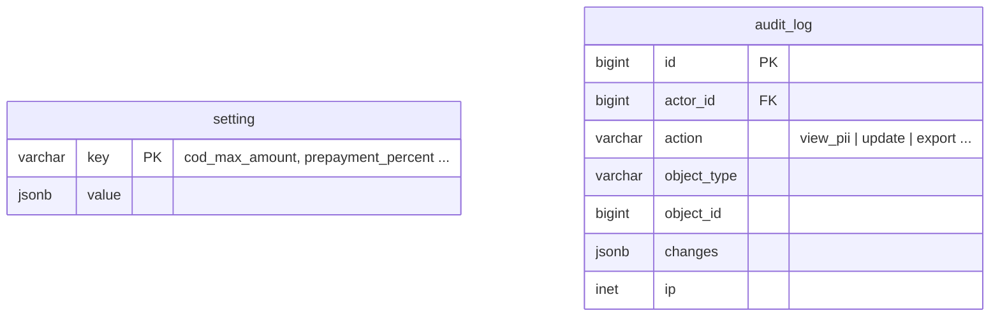

# 02. Ma'lumotlar bazasi sxemasi (ER)

Kelishuvlar:
- PK — `bigint` (identity). Tashqariga ko'rinadigan identifikatorlar alohida: `order.number`, `return_request.number`.
- Pul — `numeric(14,2)`, UZS. Payme bilan almashishda tiyinga (×100) o'giriladi.
- Ko'p tilli matnlar — `jsonb`: `{"uz": "...", "uz_cyrl": "...", "ru": "..."}`.
  `uz_cyrl` bo'sh bo'lsa, lotindan avtomatik transliteratsiya qilinadi (qo'lda tuzatish mumkin).
- Hamma jadvallarda `created_at`, `updated_at` bor (diagrammada ko'rsatilmagan).
- Snapshot maydonlar (`*_snapshot`) — buyurtma vaqtidagi holat. Tovar o'zgarsa ham tarix buzilmaydi.

## 1. accounts + geo

OTP kodlar bazada saqlanmaydi: Redis'da `otp:{phone}` → `{hash, attempts}`, TTL 120 s.

## 2. catalog

Qo'shimcha: `product_import (id, file_s3_key, status, rows_total, rows_ok, rows_failed, errors jsonb, created_by)` —
Excel import jurnali. Meilisearch indeksi `products_{uz,uz_cyrl,ru}` signallar + Celery orqali yangilanadi.

## 3. inventory

`available = on_hand - reserved`. Ombordan chiqarish va rezerv `select_for_update` bilan qilinadi.
`serial_unit` uchun `UNIQUE(variant_id, serial_number)` cheklovi bor.

## 4. cart + orders

## 5. payments + installments

## 6. logistics

Kuryer balansi = `SUM(courier_cash_entry.amount)` (faqat `cash`). Kassaga topshirishni kassir tasdiqlaydi.

## 7. warranty + reviews + promotions + notifications

Bannerlar: `banner (id, placement, image_s3_key jsonb[til], link, starts_at, ends_at, sort)`.

## 8. core

## Asosiy indekslar va cheklovlar

| Jadval | Indeks / cheklov |
|---|---|
| `user` | `UNIQUE(phone)` |
| `product_variant` | `UNIQUE(sku)`, `INDEX(product_id, is_active)` |
| `stock` | `PK(warehouse_id, variant_id)`, `CHECK(reserved <= on_hand)`, `CHECK(reserved >= 0)` |
| `serial_unit` | `UNIQUE(variant_id, serial_number)`, `UNIQUE(imei1)`, `INDEX(status)` |
| `order` | `UNIQUE(number)`, `INDEX(user_id, created_at DESC)`, `INDEX(status, created_at)` |
| `payment` | `UNIQUE(provider, provider_txn_id)`, `INDEX(order_id)` |
| `shipment` | `UNIQUE(provider, provider_shipment_id)`, `INDEX(status)` |
| `address`, `warehouse` | GiST `location`; `courier_zone` — GiST `polygon` |
| `review` | `UNIQUE(order_item_id)` — bitta xaridga bitta sharh |
